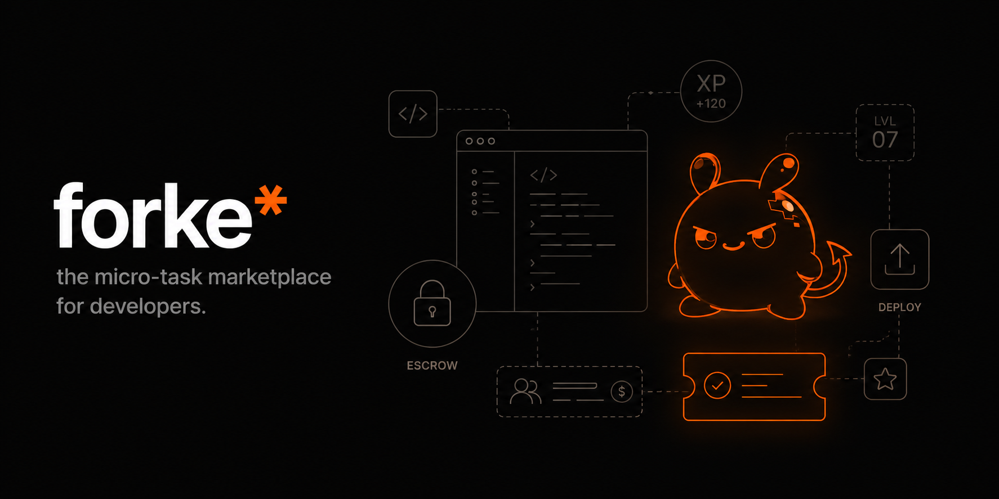

<p align="center">
  
</p>

<p align="center">
  <i>No fake projects, no long commitments, just bite-sized work with instant UPI payouts.</i>
</p>

<p align="center">
  <a href="https://www.forke.space/?source=github"><strong>Official Website</strong></a>
</p>

---

## 👋 Welcome to Forke!

Building fake CRUD apps doesn't impress recruiters. On the other side, traditional freelancing platforms require overwhelming self-marketing, proposal bidding wars, and long timelines.

**Forke is the playground where skill meets real-world rewards.**

We connect early-career developers and students with startups and indie founders who need small, highly-scoped tasks done—like fixing a bug, building a landing page section, or wiring up an API. 

It's **Fiverr × GitHub × an RPG video game** — built for developers who want to earn, not just learn.

---

## 🏛️ Forke Architecture & Repositories

Explore the core repositories powering the Forke ecosystem:

| Repository | Purpose & Role |
| :--- | :--- |
| [**`forke-marketing`**](https://github.com/forke-org/forke-marketing) | Public landing page, interactive 3D hero experiences, blogs, public developer portfolios (`/[username]`), and changelogs. |
| [**`forke-dashboard`**](https://github.com/forke-org/forke-dashboard) | Core platform portal for developers to browse and claim micro-tasks, submit pull requests, track XP/levels, and receive instant payouts. |
| [**`forke-admin`**](https://github.com/forke-org/forke-admin) | Internal admin operations console for dispute resolution, task moderation, escrow audits, user analytics, and system controls. |
| [**`forke-backend`**](https://github.com/forke-org/forke-backend) | High-performance Go REST API handling microservices, JWT authentication, database persistence, automated test sandboxes, and webhooks. |

---

## 🚀 For Developers: Ship Code, Level Up, Get Paid

Forget dry resumes and competitive bidding wars. On Forke, your code does the talking.

* 💰 **Earn Real Cash:** Solve actual, bite-sized tasks and get paid instantly to your UPI ID via a secure Razorpay escrow as soon as your work is approved.
* 🎮 **RPG Progression System:** Every task you complete awards you XP. Climb the ranks from **Script Kiddie** to **Sprint Soldier**, all the way to **Forke Legend**, unlocking exclusive platform perks and higher-paying tasks along the way.
* 📝 **Verified Proof of Work:** As you complete tasks, Forke automatically builds a gorgeous public developer portfolio for you. Every contribution is verified, timestamped, and linked directly to your GitHub commits so recruiters know your skills are 100% real.

---

## 💼 For Founders & Startups: Micro-Task Velocity

Need a quick feature built or a bug squashed, but don't want to hire a full-time freelancer?

* ⚡ **Ship in Hours, Not Weeks:** Post highly scoped micro-tasks (30 minutes to 4 hours) with a fixed budget and get matched with verified talent instantly.
* 🤖 **AI-Assisted Quality:** Every submission goes through an automated suite of checks and a deep AI code review powered by Claude before it ever hits your dashboard. You review a clean, plain-English summary of the changes.
* 🔒 **Escrow Protection:** Deposit the task budget safely. Funds are only released to the developer once you review and approve their work.

---

## 🍊 Meet Forky!

**Forky** is Forke's official mascot—a mischievous, chibi orange creature who supports you throughout your entire developer journey! He reacts dynamically to what you do on the platform:

<p align="center">
   &nbsp;&nbsp;&nbsp;&nbsp;
   &nbsp;&nbsp;&nbsp;&nbsp;
   &nbsp;&nbsp;&nbsp;&nbsp;
  
</p>

---

## 💻 Running the Ecosystem Locally

To run all Forke services on your local machine:

1. **Clone the repositories:**
   ```bash
   git clone https://github.com/forke-org/forke-marketing.git
   git clone https://github.com/forke-org/forke-dashboard.git
   git clone https://github.com/forke-org/forke-admin.git
   git clone https://github.com/forke-org/forke-backend.git
   ```

2. **Launch each service:**
   * **Backend:** `cd forke-backend && cp .env.example .env && go run ./cmd/api`
   * **Marketing:** `cd forke-marketing && cp .env.example .env.local && npm run dev`
   * **Dashboard:** `cd forke-dashboard && cp .env.example .env.local && npm run dev`
   * **Admin:** `cd forke-admin && cp .env.example .env.local && npm run dev`

---

## 📄 License

This repository is **source-available, not open-source**. The code is public for
transparency and reference, but **all rights are reserved** — you may read and fork
it on GitHub, but you may **not** use, deploy, copy, or commercialize it without
prior written permission. See [LICENSE](./LICENSE) for the full terms.
